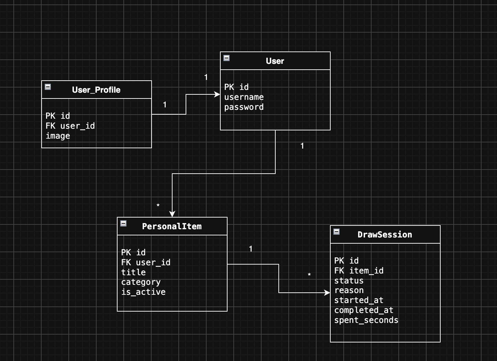
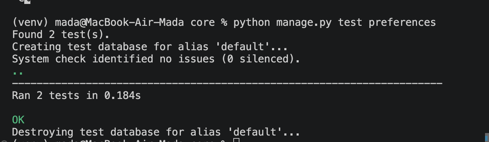
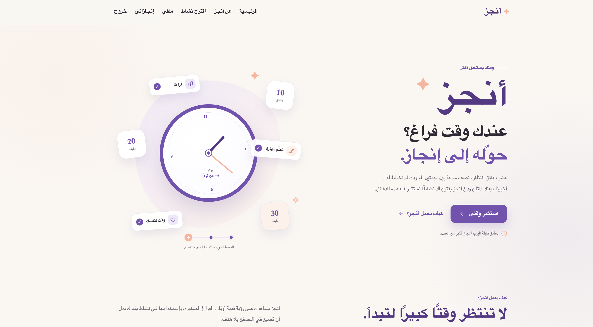
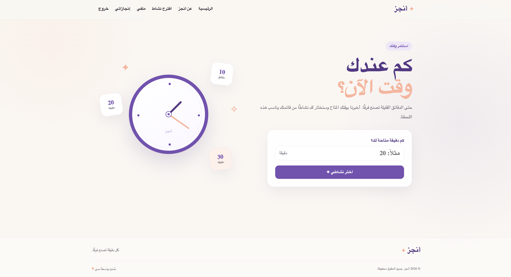
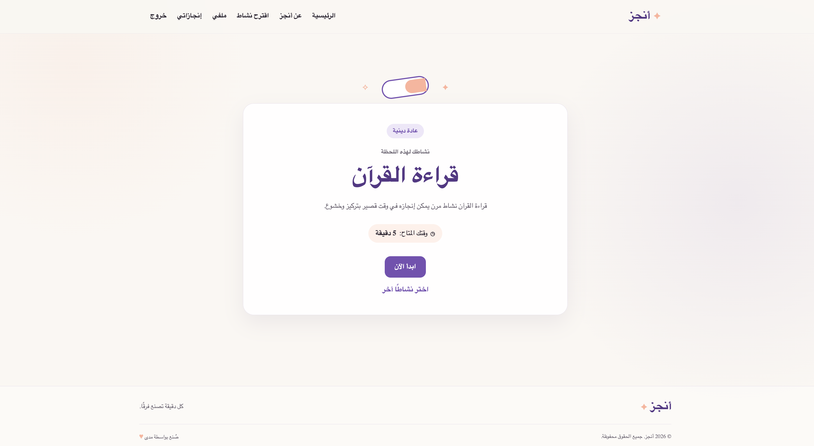
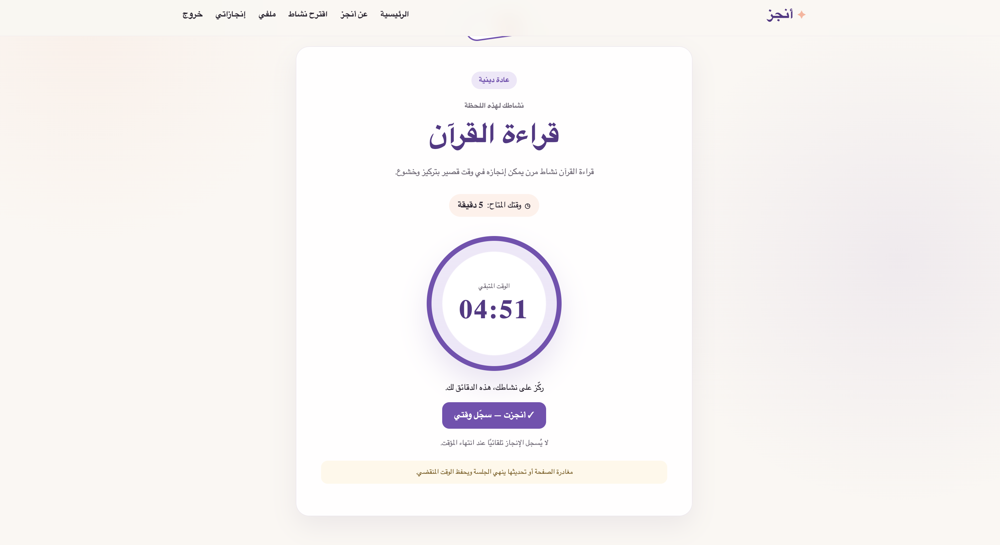
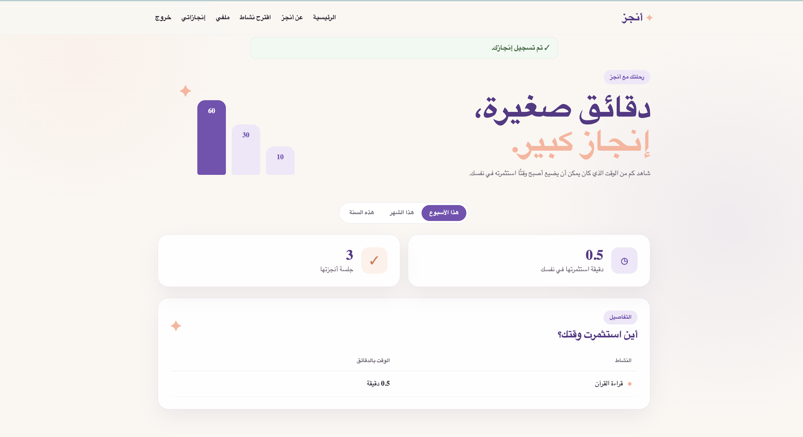
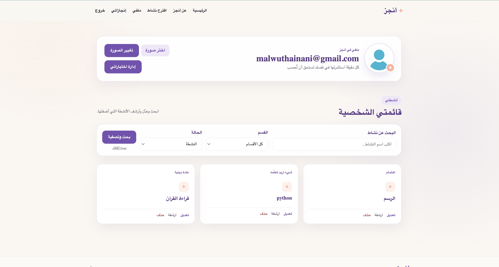
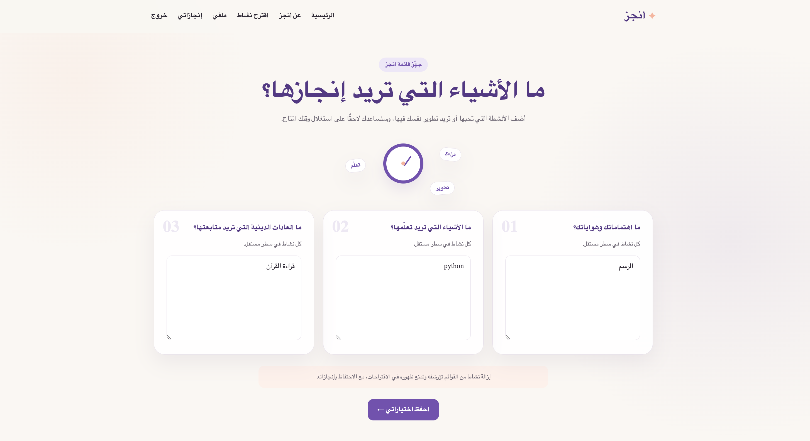

# أنجز | Anjez

## وصف المشروع

**أنجز** هو تطبيق ويب يساعدك على استغلال كل دقيقة من وقتك وتحويل أوقات الفراغ الصغيرة إلى فرص للإنجاز والنمو.

قد يكون لديك 10 دقائق أثناء الانتظار، أو نصف ساعة بين مهمتين، أو وقت فراغ لم تخطط له. بدلًا من قضاء هذا الوقت في التصفح والـ Scrolling على وسائل التواصل الاجتماعي، يساعدك **أنجز** على اختيار نشاط مفيد من اهتماماتك وأهدافك يتناسب مع الوقت المتاح لديك.

يحدد المستخدم الوقت المتاح، ويقترح له التطبيق نشاطًا مناسبًا من قائمته، ثم يتابع الوقت الذي قضاه في النشاط ويسجل إنجازه.

كما يجمع **أنجز** الدقائق التي استثمرها المستخدم في نفسه ويعرضها في تقارير أسبوعية وشهرية وسنوية، حتى يستطيع رؤية أثر الأوقات الصغيرة مع مرور الوقت.

قد تبدو بضع دقائق غير مهمة، لكن في نهاية الأسبوع أو الشهر قد تتفاجأ بحجم ما أنجزته، وكم من الوقت الذي كان يمكن أن يضيع أصبح وقتًا استثمرته في التعلم والنمو وتطوير نفسك.

---

## المشكلة

نملك خلال يومنا الكثير من أوقات الفراغ القصيرة، مثل وقت الانتظار أو الوقت بين المهام، وغالبًا لا نشعر بقيمتها لأنها موزعة على عدة دقائق خلال اليوم.

في كثير من الأحيان نلجأ تلقائيًا خلال هذه الفترات إلى تصفح وسائل التواصل الاجتماعي والـ Scrolling، ثم تنتهي الدقائق دون إنجاز شيء مفيد.

المشكلة ليست دائمًا عدم وجود الوقت، بل عدم استغلال الأوقات الصغيرة التي نملكها بالفعل، بالإضافة إلى الحيرة في تحديد ما يمكن إنجازه خلال الوقت المتاح.

**أنجز** يحاول حل هذه المشكلة من خلال تحويل السؤال من:

> "ماذا أفعل الآن؟"

إلى:

> "لدي 20 دقيقة، ماذا يمكنني أن أنجز خلالها؟"

يقترح التطبيق نشاطًا مناسبًا من اهتمامات المستخدم، ويساعده على تتبع الوقت الذي استثمره في نفسه حتى يرى أثر هذه الدقائق بشكل واضح في تقارير إنجازاته.

---

## المستخدمون المستهدفون

يستهدف **أنجز** الأشخاص الذين يرغبون في تطوير أنفسهم واستغلال وقتهم بشكل أفضل، خصوصًا من لديهم العديد من الاهتمامات والأهداف ولكنهم يجدون صعوبة في اختيار ما يبدأون به خلال أوقات الفراغ القصيرة.

ومن أمثلتهم:

- الطلاب والمتدربون.
- الموظفون الذين لديهم أوقات انتظار أو فترات قصيرة بين المهام.
- الأشخاص الذين يتعلمون مهارات جديدة.
- الأشخاص الذين لديهم هوايات أو أهداف شخصية متعددة.
- أي شخص يريد تقليل الوقت الذي يقضيه في التصفح غير الهادف واستبداله بوقت يساعده على الإنجاز والنمو.

الهدف من **أنجز** ليس فقط إدارة الوقت، بل مساعدة المستخدم على رؤية قيمة الدقائق الصغيرة التي كان يتجاهلها، وتحويلها مع الوقت إلى **إنجاز كبير يمكن قياسه ومتابعته**.


---

## المميزات

- إنشاء حساب وتسجيل الدخول.
- إضافة اهتمامات وأنشطة شخصية.
- عرض وتعديل الأنشطة.
- أرشفة واستعادة الأنشطة.
- حذف الأنشطة عندما تسمح العلاقات بذلك.
- البحث وتصفية الأنشطة.
- اقتراح نشاط حسب الوقت المتاح.
- استخدام مؤقت لمتابعة النشاط.
- تسجيل وقت الإنجاز.
- إلغاء الجلسات.
- تقرير أسبوعي أو شهري أو سنوي للإنجازات.
- البحث داخل الإنجازات.
- Pagination لنتائج الإنجازات.
- رفع صورة شخصية للمستخدم.
- استخدام Aggregation و Annotation في تقرير الإنجازات.

---

## سير عمل المستخدم

1. ينشئ المستخدم حسابًا أو يسجل الدخول.
2. يضيف اهتماماته والأنشطة التي يريد القيام بها.
3. يحدد الوقت المتاح.
4. يقترح التطبيق نشاطًا مناسبًا.
5. يبدأ المستخدم النشاط والمؤقت.
6. عند الانتهاء يتم تسجيل الإنجاز.
7. يستطيع المستخدم مشاهدة تقرير إنجازاته والوقت الذي قضاه في كل نشاط.

---

## التقنيات المستخدمة

- Python
- Django
- SQLite
- HTML
- CSS
- JavaScript
- Django ORM

---

## قاعدة البيانات

يستخدم المشروع Django Models وقاعدة بيانات SQLite.

العلاقات الأساسية تشمل:

- `User` مرتبط ببيانات المستخدم.
- `User` لديه عدة `PersonalItem`.
- كل `PersonalItem` يمكن أن يرتبط بعدة `DrawSession`.
- يتم استخدام العلاقات لحماية بيانات الإنجازات والمحافظة على سجل النشاط.

### ERD



---

## Wireframe

يوضح الـ Wireframe التصميم الأولي ومسار المستخدم داخل التطبيق.


---

## ORM

يستخدم المشروع Django ORM في الوظائف الأساسية، ومنها:

- CRUD لإدارة الأنشطة.
- Filtering للبحث وتصفية النتائج.
- Ordering لترتيب النتائج.
- Relationship Queries للوصول إلى بيانات المستخدم والأنشطة والجلسات المرتبطة.
- Aggregation لحساب إجمالي وقت الإنجاز.
- Annotation لحساب إجمالي الوقت لكل نشاط.

---

## تثبيت وتشغيل المشروع

### 1. تحميل المشروع

```bash
git clone https://github.com/mada-coding-challenge/Tuwaiq_Python_final_Anjez
```

ثم:


### 2. إنشاء Virtual Environment

```bash
python3 -m venv venv
```

### 3. تشغيل البيئة

macOS / Linux:

```bash
source venv/bin/activate
```

Windows:

```bash
venv\Scripts\activate
```

### 4. تثبيت المتطلبات

```bash
pip install -r requirements.txt
```

### 5. إنشاء قاعدة البيانات

```bash
python manage.py migrate
```

### 6. تشغيل المشروع

```bash
python manage.py runserver
```

ثم افتح:

```text
http://127.0.0.1:8000/
```

---


## بيانات تجريبية

يمكن إنشاء حساب جديد من صفحة التسجيل ثم إضافة عدة أنشطة، مثل:

- تعلم Django
- قراءة كتاب
- تعلم اللغة الإنجليزية
- ممارسة هواية

بعد ذلك يمكن تجربة الاقتراح والمؤقت وتسجيل عدة إنجازات لعرض التقرير.

---

## الاختبارات

يحتوي المشروع على Automated Tests بسيطة لبعض الوظائف الأساسية.

لتشغيل الاختبارات:

```bash
python manage.py test
```

### نتيجة الاختبارات



---

## Verification

تم اختبار الوظائف الأساسية مثل:

- إنشاء البيانات وعرضها وتعديلها.
- أرشفة واستعادة الأنشطة.
- حذف النشاط عند السماح بذلك.
- البحث والتصفية.
- التعامل مع النتائج الفارغة.
- تسجيل الدخول ومنع الوصول غير المصرح.
- تسجيل الإنجازات.
- Aggregation و Annotation.
- عرض الموقع على أحجام شاشات مختلفة.

---

## Screenshots

### الصفحة الرئيسية




### اقتراح النشاط





### بدء المؤقت



### تقرير الإنجازات



### الملف الشخصي




### إدخال الإهتمامات والأهداف



---

## Demo

لتجربة المسار الأساسي للمشروع:

1. إنشاء حساب.
2. إضافة مجموعة من الاهتمامات.
3. الانتقال إلى اقتراح النشاط.
4. تحديد الوقت المتاح.
5. الحصول على اقتراح.
6. بدء المؤقت.
7. إنهاء النشاط وتسجيل الإنجاز.
8. فتح صفحة الإنجازات ومشاهدة التقرير.

---

## القيود الحالية

- المشروع يستخدم SQLite حاليًا.
- بعض الوظائف التي تعتمد على خدمات خارجية تحتاج إلى اتصال بالإنترنت وإعداد API صحيح.
- المشروع غير منشور حاليًا على خادم Production.

---

## تطويرات مستقبلية

- تحسين نظام اقتراح الأنشطة.
- إضافة إحصائيات أكثر تفصيلًا.
- إضافة إشعارات وتذكيرات.
- نشر التطبيق على خادم Production.
- تحسين تجربة المستخدم على الأجهزة المختلفة.

---

## Design & Project Files

- [ERD](docs/images/erd.png)
- [Automated Tests Result](docs/images/tests.png)


---

## External Resources

تم استخدام Django Documentation والمصادر التعليمية الخاصة بالمعسكر، بالإضافة إلى أدوات الذكاء الاصطناعي للمساعدة في التعلم ومراجعة بعض أجزاء المشروع. تم تعديل واختبار الكود بما يتناسب مع متطلبات المشروع.

### Live Link | رابط التطبيق

[Live app](https://tuwaiqpythonfinalanjez-production.up.railway.app/)
